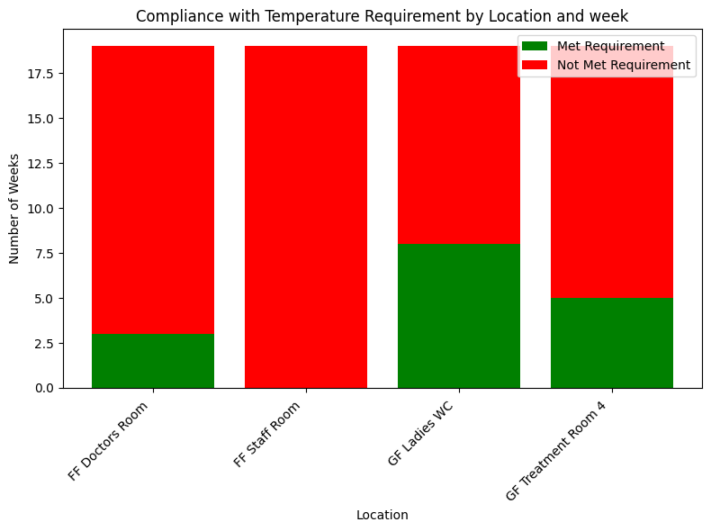
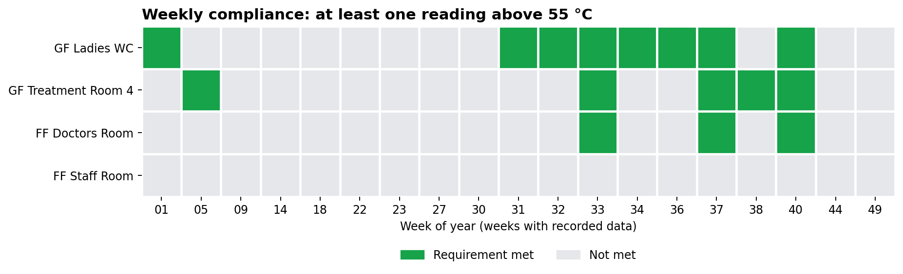
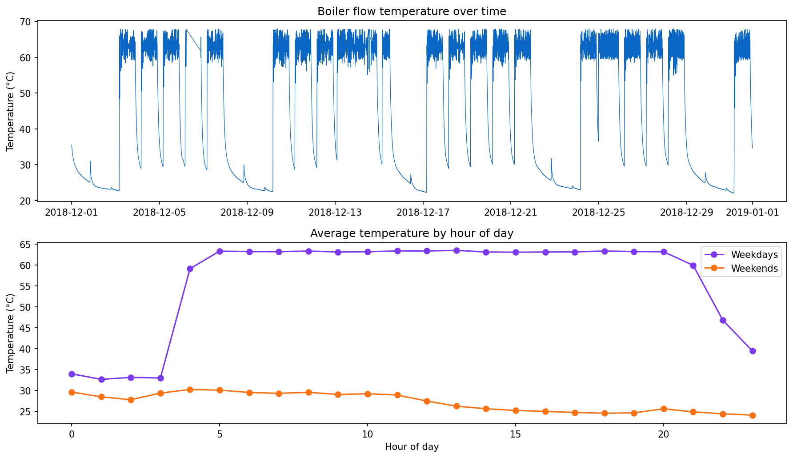
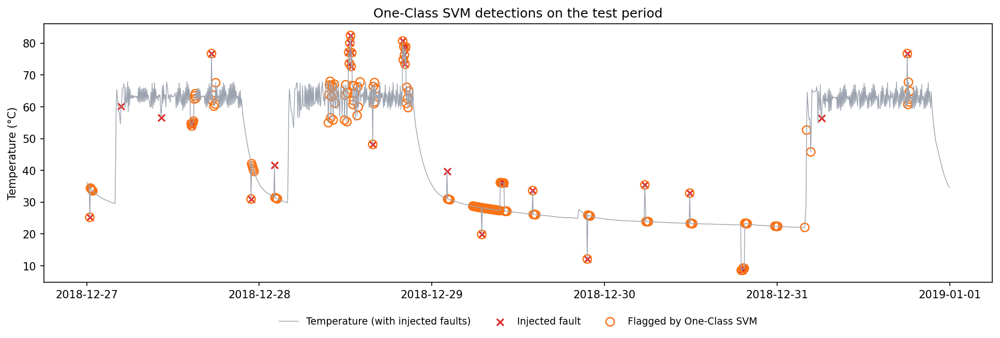

<h1 align="center">🌡️ Building Temperature Monitoring</h1>

<p align="center">
  <i>Weekly hot-water compliance checks and boiler anomaly detection with Python, pandas and scikit-learn.</i>
</p>

<p align="center">
  
  
  
  
  
</p>

---

> ### ⚡ TL;DR
> - **Hot water:** over 9 weeks, **no location met the 55 °C rule every week**. The FF Staff Room never went above **27.8 °C**, so that pipe or sensor needs a physical check.
> - **Boiler:** a One-Class SVM caught **85% of planted faults** with **0.64 precision**, almost **4× the F1** of the best baseline (0.73 vs 0.20), while learning the boiler's weekday on/off schedule.
> - **Biggest lesson:** unlabelled sensor data needs an honest evaluation. I planted known faults instead of trusting a meaningless accuracy score.

---

## 📑 Contents

1. [Overview](#-overview)
2. [Key Results](#-key-results)
3. [Data & Schema](#-data--schema)
4. [Notebook 01: Hot Water Compliance](#-notebook-01-hot-water-compliance)
5. [Notebook 02: Boiler Anomaly Detection](#-notebook-02-boiler-anomaly-detection)
6. [Recommendations](#-recommendations)
7. [Challenges & Lessons](#-challenges--lessons)
8. [Limitations & Next Steps](#-limitations--next-steps)
9. [Repository Structure](#-repository-structure)
10. [How to Run](#-how-to-run)

---

## 🎯 Overview

Facilities teams need to know **where hot water is not getting hot enough** and **when boiler readings look abnormal**. This project answers both questions from sensor data. It was originally completed as a technical assessment.

| | Notebook | Question | Approach |
|---|---|---|---|
| **01** | [Hot Water Compliance](notebooks/01_hot_water_compliance_analysis.ipynb) | Does each location reach **more than 55 °C at least once every week**? | Weekly grouping, rule check, compliance charts |
| **02** | [Boiler Anomaly Detection](notebooks/02_boiler_anomaly_detection.ipynb) | Can unusual boiler flow temperatures be flagged automatically? | Lag and schedule features, One-Class SVM, tested with synthetic faults |

---

## 📈 Key Results

<div align="center">

| 📊 **5,919** | 🚫 **0 of 9 weeks** | 🥇 **6 of 9 weeks** | 🌡️ **27.8 °C** |
|:---:|:---:|:---:|:---:|
| pipe readings across 4 locations | FF Staff Room weeks meeting the 55 °C rule | best location (GF Ladies WC) | the FF Staff Room's highest reading ever |

| 🎯 **F1 0.73** | 🔎 **85%** | ⚖️ **3.7×** |
|:---:|:---:|:---:|
| One-Class SVM on planted boiler faults | of planted faults caught | SVM F1 versus the best baseline |

</div>

---

## 🗂️ Data & Schema

> The data used for this project is from Acutro Ltd UK, a London-based proptech (property technology) company that specializes in data infrastructure, analytics, and smart building solutions for commercial real estate and facilities management. The data has been added to this repository, and you can use it to re-run the notebooks (see [How to Run](#-how-to-run)).

### `hot-water-pipe-temperature.csv` (Notebook 01)

**5,919 rows · 3 columns · no missing values · irregular intervals · 31 July to 25 September 2019 (9 weeks)**

| Column | Type | Description | Example |
|---|---|---|---|
| `Timestamp` | text → datetime | Date and time of the reading, written `dd/mm/yyyy hh:mm` | `18/09/2019 09:24` |
| `Location` | text (categorical) | Sensor location, 4 values (counts below) | `FF Doctors Room` |
| `Value` | float | Pipe temperature in °C | `14.75` |

| Location | Readings | Mean (°C) | Max (°C) |
|---|---:|---:|---:|
| GF Treatment Room 4 | 1,636 | 22.9 | 63.4 |
| GF Ladies WC | 1,492 | 21.9 | 65.6 |
| FF Doctors Room | 1,462 | 22.6 | 61.4 |
| FF Staff Room | 1,329 | 21.8 | 27.8 |

**Summary of `Value` (°C)**

| count | mean | std | min | 25% | 50% | 75% | max |
|---:|---:|---:|---:|---:|---:|---:|---:|
| 5,919 | 22.32 | 7.14 | 14.75 | 18.81 | 20.43 | 22.43 | 65.56 |

> **Data quirks handled in the notebook**
> - **Day/month order.** Dates are day-first. Letting pandas guess can swap day and month for dates like `08/06/2019`, which stretches two months of data across the whole year. The notebook gives the exact format `%d/%m/%Y %H:%M`.
> - **Byte-order mark.** The file starts with a hidden BOM, so it is read with `encoding="utf-8-sig"`.
> - **Trailing spaces.** Every location name ends in a space (`"FF Staff Room "`); the notebook strips them.

### `boiler-flow-temperature.csv` (Notebook 02)

**8,484 rows · 2 columns · a reading about every 5 minutes · 1 to 31 December 2018**

| Column | Type | Description | Example |
|---|---|---|---|
| `timestamp` | integer (epoch milliseconds) | Time of the reading; converted with `pd.to_datetime(..., unit='ms')` | `1543622414000` → `2018-12-01 00:00:14` |
| `value` | float | Boiler flow temperature in °C | `35.5` |

| count | mean | std | min | 25% | 50% | 75% | max |
|---:|---:|---:|---:|---:|---:|---:|---:|
| 8,484 | 46.57 | 17.88 | 22.00 | 26.75 | 58.12 | 63.19 | 68.06 |

> **What the series looks like**
> - The boiler runs a **daily on/off schedule on weekdays**: about 55 to 68 °C from roughly 04:00 to 21:00, then cooling overnight. **Weekends stay mostly cold** (22 to 35 °C).
> - Because it jumps between two levels, the overall standard deviation (17.9 °C) is inflated, so synthetic faults are sized in °C.
> - There is one **outage of about 15 hours 42 minutes on 6 December** and many short gaps of 10 to 20 minutes.
> - The raw column names have a **leading space** (`" timestamp"`, `" value"`); the notebook strips them.

**Features built for the model**

| Feature | Type | Description |
|---|---|---|
| `value` | float | Current reading |
| `value_lag1` … `value_lag5` | float | The previous 5 readings (the "memory" window) |
| `hour_sin`, `hour_cos` | float | Time of day as a point on a 24-hour circle, so 23:55 and 00:05 are close together |
| `is_weekend` | 0 / 1 | Saturday or Sunday, because the boiler runs a different schedule at weekends |

Rows are dropped when they have no full history or when their 5 previous readings span a **data gap longer than 30 minutes** (13 of 8,484 rows).

---

## 🧪 Notebook 01: Hot Water Compliance

**Question:** *Does every location reach more than 55 °C at least once each week?*

**Method**

1. Load the data (handling the BOM and trailing spaces) and check for missing values
2. Convert `Timestamp` to datetime with the exact day-first format, and confirm all readings fall in one year
3. Group readings by `Location` and week of year (`%U`, weeks start on Sunday)
4. Mark each location-week `True` if any reading is above 55 °C
5. Check that every location-week has readings
6. Visualise compliance

### 📸 Snapshots

**Weeks meeting the requirement, by location**

<p align="center">
  
</p>

**Week-by-week view**

<p align="center">
  
</p>

### Findings

| Rank | Location | Weeks met | Compliance |
|:---:|---|:---:|:---:|
| 1 | GF Ladies WC | 6 / 9 | 67% |
| 2 | GF Treatment Room 4 | 5 / 9 | 56% |
| 3 | FF Doctors Room | 3 / 9 | 33% |
| 4 | FF Staff Room | 0 / 9 | **0%** |

- **No location met the rule every week.**
- **FF Staff Room never came close.** Its highest reading was 27.8 °C, so the problem is not a marginal miss: that pipe never gets hot. It is the first place to investigate (distance from the boiler, flow rate or sensor placement).
- **Weeks 33, 36 and 37** were the strongest, with three of the four locations meeting the rule. **Weeks 30 and 31** were the weakest, with none.
- Hot readings are rare: only **59 of 5,919** readings are above 55 °C.
- **Weeks 30 and 38 are partial** (the data starts and ends on a Wednesday), so a "not met" in those weeks deserves extra care.

---

## 🤖 Notebook 02: Boiler Anomaly Detection

**Question:** *Can we flag unusual boiler flow temperatures automatically?*

The boiler data has **no labels** saying which readings are faults. The notebook therefore teaches a One-Class SVM what "normal" looks like, then **plants synthetic faults** in data the model has never seen, to measure how many it catches.

**Pipeline**

```
raw readings → clean → lag, time-of-day and weekend features → time-based split
      → train on first 21 days (scaler + One-Class SVM, fitted on training data only)
      → tune on next 5 days (grid search on nu and gamma, scored with planted faults)
      → final test on last 5 days vs Isolation Forest and a rolling z-score rule
```

| Design choice | Detail |
|---|---|
| **Split** | Train: 1 to 21 Dec · Validation: 22 to 26 Dec · Test: 27 to 31 Dec, always in time order |
| **No leakage** | `StandardScaler` and the SVM sit in one `Pipeline`, fitted on training data only |
| **Planted faults** | 20 each in validation and test: spikes, dips and 6-reading level shifts, **6 to 15 °C** in size; different random faults in each period |
| **Tuning** | `nu` ∈ {0.005 … 0.10} × `gamma` ∈ {0.05 … 2.0}, chosen by validation F1. Both baselines are tuned the same way |
| **Baselines** | Isolation Forest and a rolling z-score (standard deviations from the previous 12 readings) |
| **Metrics** | Precision, recall, F1, ROC-AUC, average precision, and event recall (share of faults with at least one flagged reading) |

### 📸 Snapshots

**The weekday on/off schedule the model has to learn**

<p align="center">
  
</p>

**Detections on the test period** (red crosses are planted faults, orange circles are SVM flags)

<p align="center">
  
</p>

### Results (test period, 27 to 31 December)

| Method | Precision | Recall | F1 | ROC-AUC | Event recall |
|---|:---:|:---:|:---:|:---:|:---:|
| **One-Class SVM** (`nu = 0.01`, `gamma = 0.5`) | **0.64** | **0.85** | **0.73** | **0.89** | 0.85 |
| Isolation Forest (`contamination = 0.10`) | 0.20 | 0.19 | 0.20 | 0.73 | 0.25 |
| Rolling z-score (threshold 2.0) | 0.16 | 0.18 | 0.17 | 0.40 | 0.90 |

- The **One-Class SVM clearly beats both baselines** (F1 0.73 versus 0.20 and 0.17). The rolling z-score scores below chance on ROC-AUC (0.40) because the boiler's normal on/off jumps look like faults to it, and its high event recall just reflects that it flags 11.6% of all readings.
- Many of the SVM's false alarms come from the **noisy daytime plateau** (55 to 68 °C), where normal fluctuations are large.

**Sensitivity to fault size** (same trained model, test period)

| Planted fault size | Precision | Recall | F1 | Event recall |
|---|:---:|:---:|:---:|:---:|
| Small (3 to 6 °C) | 0.54 | 0.55 | 0.54 | 0.60 |
| Medium (6 to 15 °C) | 0.64 | 0.85 | 0.73 | 0.85 |
| Large (15 to 25 °C) | 0.67 | 0.94 | 0.78 | 0.95 |

Detection drops quickly for small faults, so subtle drift would likely be missed.

### Applied to the real data

Run on every real reading, the model flags **241 of 8,471 readings (2.8%)**, grouped into **50 events**. These are candidates to check against boiler logs, **not confirmed faults**. Examples:

| When | What was flagged |
|---|---|
| Sat 22 Dec, 05:11 to 11:01 | 68 readings between 27 and 29 °C: a long stretch slightly warmer than a normal weekend morning |
| Mon 24 Dec 23:41 to Tue 25 Dec 00:16 | 8 readings between 54 and 67 °C around midnight, when the boiler is normally off |
| Fri 28 Dec, 09:36 to 14:01 | Three events of 55 to 68 °C readings during the working day |
| Sun 30 Dec 23:40 to Mon 31 Dec 00:05 | 5 readings at 22.4 °C |

Flags inside the training period (1 to 21 Dec) are in-sample and less informative.

---

## 💡 Recommendations

| Priority | Action | Based on |
|:---:|---|---|
| 1 | **Physically inspect the FF Staff Room pipe and sensor** (distance from the boiler, flow rate, sensor placement) | It never exceeded 27.8 °C in 9 weeks, so this is not a marginal miss |
| 2 | **Compare weeks 30 and 31 (no location compliant) with weeks 33, 36 and 37 (three of four compliant)** to find what changed | Notebook 01 weekly heatmap |
| 3 | **Use the anomaly model as a screening tool with human review**, for example a daily digest of flagged events | About one in three flags is a false alarm, mostly on the noisy daytime plateau |
| 4 | **Start logging confirmed boiler faults** | Real labels would replace the synthetic test and allow proper tuning |

---

## 🧠 Challenges & Lessons

| Challenge | What I did |
|---|---|
| **Day and month were being swapped.** Dates are `dd/mm/yyyy`, and automatic parsing misread ambiguous dates, stretching 9 weeks of data across 19 | Gave pandas the exact format and added a check that all readings fall in one year |
| **Messy file.** Hidden byte-order mark, trailing spaces in location names, leading spaces in column names | Cleaned on load so the notebooks run on the raw files |
| **No fault labels**, so accuracy cannot be measured directly | Planted known faults in unseen data and reported precision, recall, F1 and event recall |
| **Boiler on/off cycle** inflated the standard deviation and made "normal" depend on weekday and time | Added time-of-day and weekend features, and sized faults in °C |
| **Sensor outage** of about 15 hours | Dropped rows whose history spans a long gap so stale readings are never used as "recent" |
| **Risk of an over-optimistic result** | Time-ordered split, scaler fitted on training data only, and baselines tuned as carefully as the SVM |

---

## 🔧 Limitations & Next Steps

| Area | Current state | Next step |
|---|---|---|
| **Labels** | Performance is measured on **synthetic** faults, because the data has no real labels | Get a maintenance or fault log and test on real events |
| **Fault realism** | Spikes, dips and level shifts only; small faults are caught much less often | Add slow drift and stuck-sensor faults |
| **History** | One month of boiler data, so seasons and holidays (such as Christmas Day) are not represented | Use a longer history and retrain periodically |
| **Training data** | May already contain real faults (such as the 6 December outage) | Remove known fault periods before training |
| **Precision** | About one in three flags is a false alarm, mostly on the noisy daytime plateau | Add features such as rate of change or time since the boiler switched on |
| **Notebook 01 coverage** | 9 weeks, with weeks 30 and 38 only partly covered | Report partial weeks separately |

---

## 📁 Repository Structure

```
building-temperature-monitoring/
├── README.md
├── requirements.txt
├── notebooks/
│   ├── 01_hot_water_compliance_analysis.ipynb
│   └── 02_boiler_anomaly_detection.ipynb
├── images/
│   ├── compliance_by_location.png
│   ├── weekly_compliance_heatmap.png
│   ├── boiler_series_overview.png
│   └── boiler_anomaly_detections.png
└── data/                                   # not committed: add the CSVs here
    ├── hot-water-pipe-temperature.csv
    └── boiler-flow-temperature.csv
```

---

## ▶️ How to Run

```bash
git clone https://github.com/Veckey5/building-temperature-monitoring.git
cd building-temperature-monitoring
pip install -r requirements.txt
jupyter notebook notebooks/
```

Run the notebooks **in order** with *Run All*. Each one finds its CSV automatically in `data/`, or in the current folder.
On **Google Colab**, click a badge above, upload the CSV file when needed, and run all cells.

---
